# C

<a class="game" href="https://bi3mer.github.io/crossword/">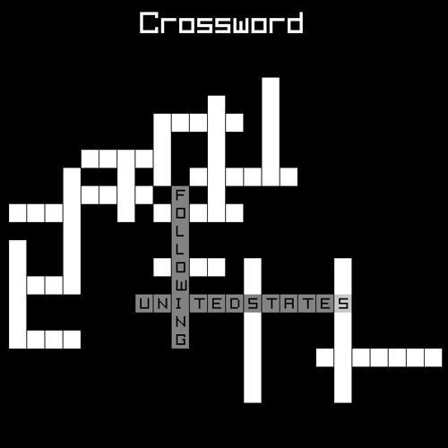Play</a>
<a class="game" href="https://github.com/bi3mer/c-wordle">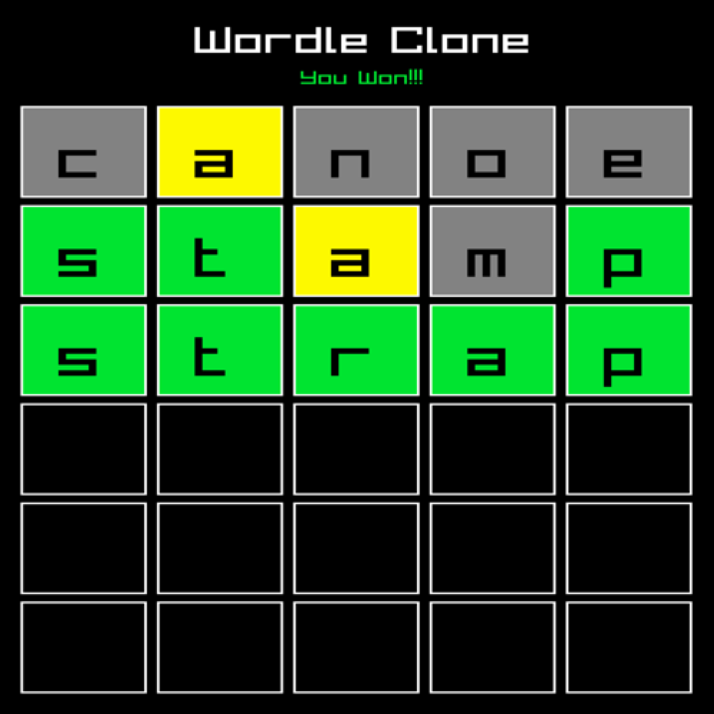Play</a>
<a class="game" href="https://github.com/bi3mer/c-tic-tac-toe">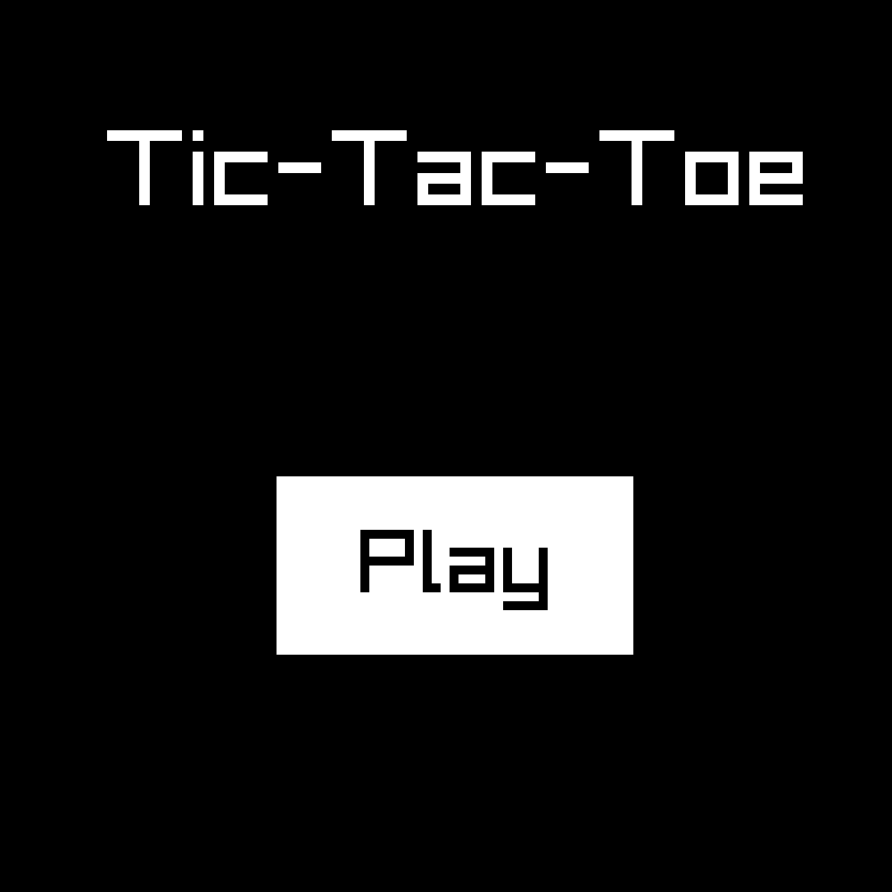Play</a>
<a class="game" href="https://github.com/bi3mer/c-snake">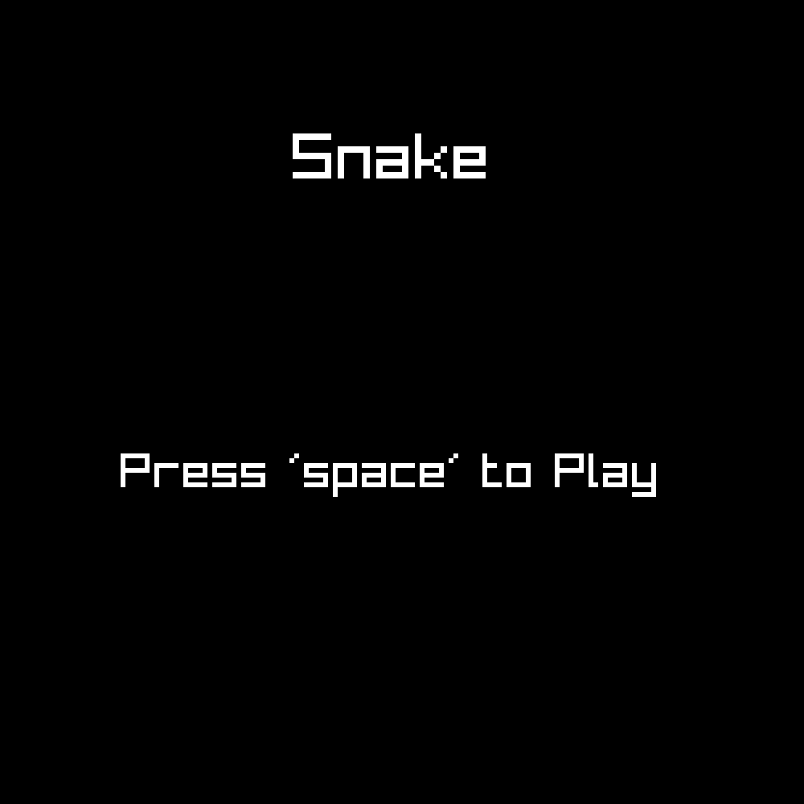Play</a>
<a class="game" href="https://github.com/bi3mer/raylib-pong">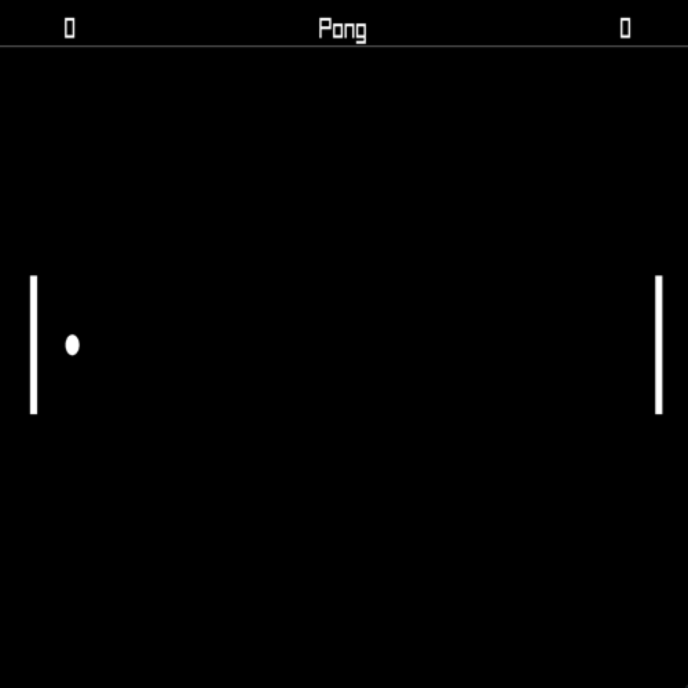Play</a>

# TypeScript

<a class="game" href="https://bi3mer.github.io/recformer/index.html?default=true">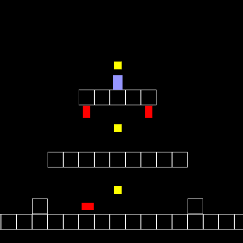Play</a>
<a class="game" href="https://bi3mer.github.io/dg/index.html?default=true">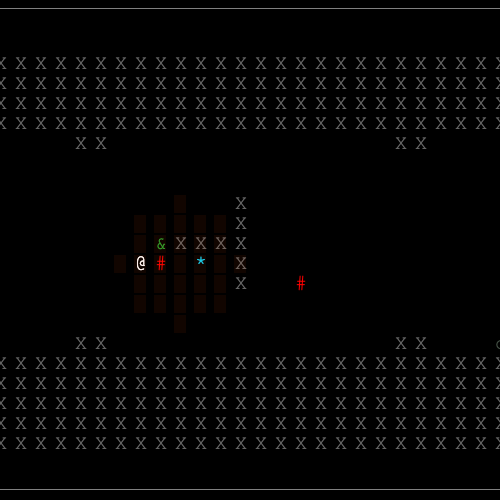Play</a>
<a class="game" href="https://bi3mer.github.io/match-three/">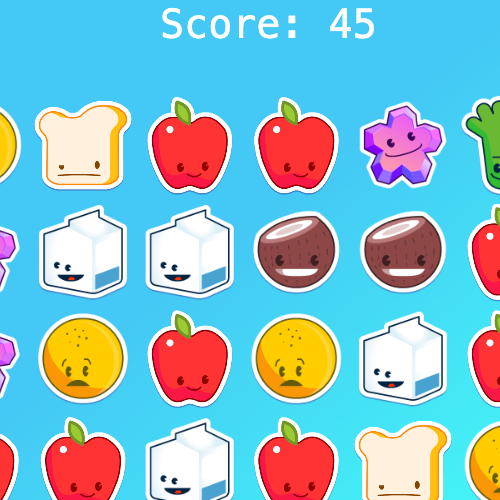Play</a>
<a class="game" href="https://bi3mer.github.io/scary_dungeon_js/">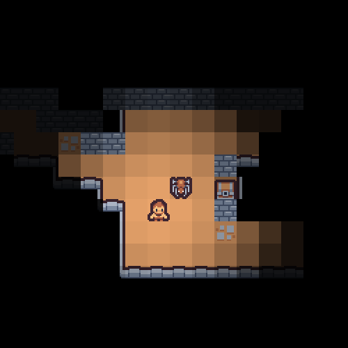Play</a>
<a class="game" href="https://bi3mer.github.io/quad_tree_visualization/">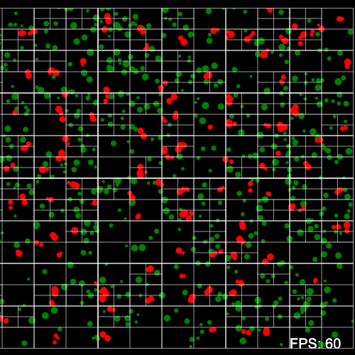Watch</a>
<a class="game" href="https://bi3mer.github.io/doom-fire/">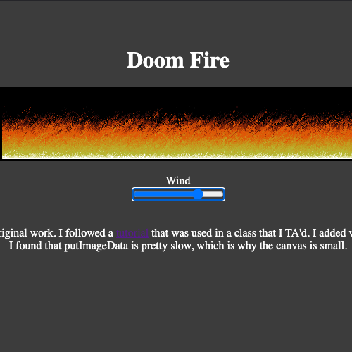Watch</a>
<a class="game" href="https://bi3mer.github.io/rock_paper_scissors/">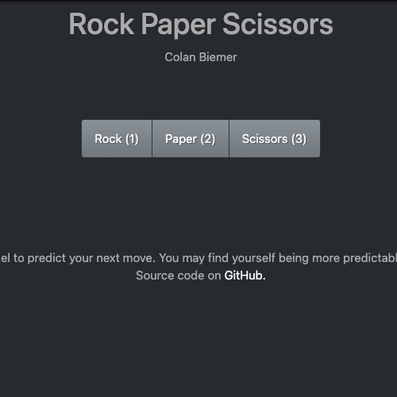Play</a>
<a class="game" href="https://bi3mer.github.io/tic-tac-toe/">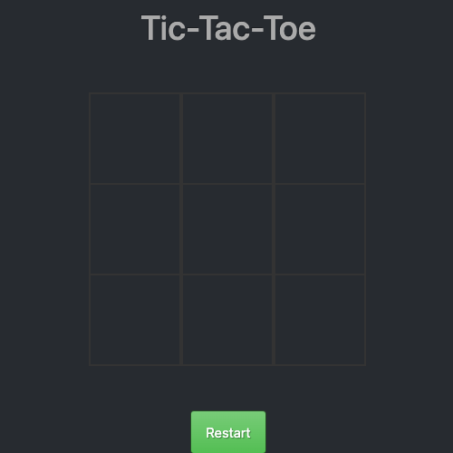Play</a>

# C++

<a class="game" href="https://bi3mer.github.io/raylib_tests/snake/">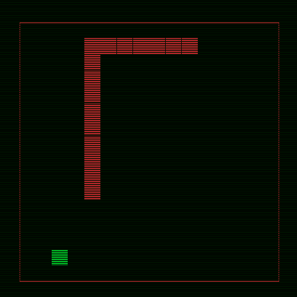Play</a>
<a class="game" href="https://bi3mer.github.io/raylib_tests/pong/">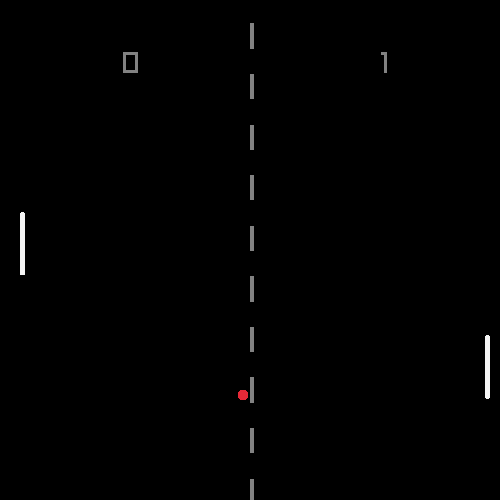Play</a>
<a class="game" href="https://bi3mer.github.io/raylib_tests/hilbert_curves/">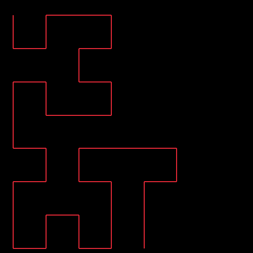Watch</a>
<a class="game" href="https://bi3mer.github.io/raylib_tests/conways_game_of_life/">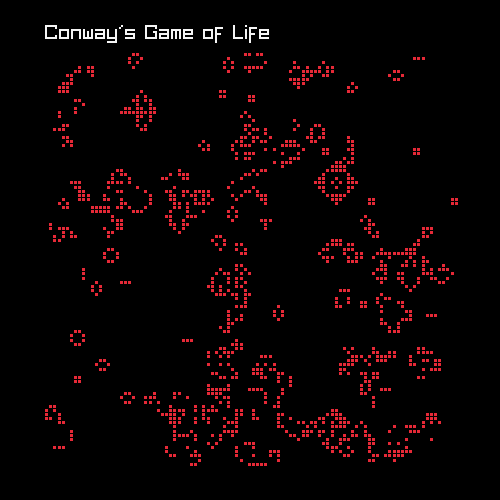Watch</a>

# Rust

<a class="game" href="https://bi3mer.github.io/connect-four/">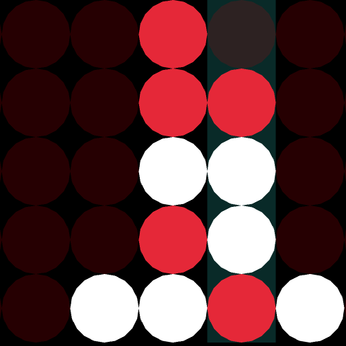Play</a>
<a class="game" href="https://bi3mer.github.io/pongrs/">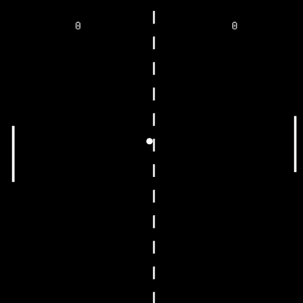Play</a>

